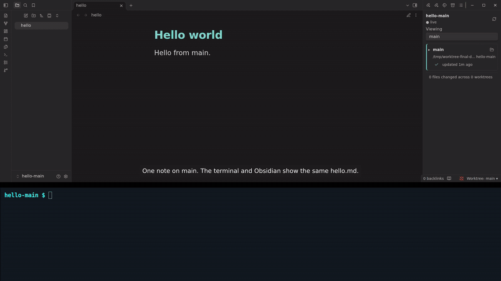

# Worktree Switcher

Switch Obsidian's notes and file tree between Git worktrees in the same window.
Inspect changed files, read diffs, and preview Markdown.

[Download 0.0.5](https://github.com/rohitgirdhar/obsidian-worktree-switcher/releases/tag/0.0.5)



[Watch the terminal and Obsidian demo](https://raw.githubusercontent.com/rohitgirdhar/obsidian-worktree-switcher/main/assets/walkthrough.mp4).
Recorded with Worktree Switcher 0.0.4 and Obsidian 1.14.4. Open **Switch Worktrees**,
create a worktree in the terminal, and edit `hello.md`. Switch Obsidian to see the
new contents, inspect the diff and Markdown preview, and watch another terminal
edit update the note live. Switching back shows main's original text.

## Install and update

Requires desktop Obsidian 1.14.4 or later and Git on PATH.

1. Download `main.js`, `manifest.json`, and `styles.css` from the release page.
2. Copy all three into `<vault>/.obsidian/plugins/worktree-switcher/`.
3. Enable **Worktree Switcher** in Settings → Community plugins.

[Community directory listing](https://community.obsidian.md/plugins/worktree-switcher).
Availability in Obsidian depends on directory review and publication.

For automatic updates before directory availability, use
[BRAT](https://github.com/TfTHacker/obsidian42-brat) to add
`rohitgirdhar/obsidian-worktree-switcher`, select **Latest version**, and enable
its update checks at startup. Manual installations require downloading each release.

## Use

Open a vault inside the main checkout of a Git repository. Create worktrees with
Git or another tool, for example `git worktree add ../hello-edit -b edit-hello`.
Each worktree must contain the vault at the same relative path.

Open **Worktree Switcher: Switch Worktrees** from the command palette, or click
the Worktree Switcher ribbon icon. Click a worktree's two-arrow icon to switch; a check
marks the current worktree. The panel picker and status-bar picker also switch.
Expand a row to open its changed-file diff or Markdown preview.

Notes and the file tree change in place. Settings and plugins stay in the vault
you originally opened. Normal edits write to the worktree you are viewing.
Hidden files are omitted from change lists unless enabled in plugin settings.

Every switch carries your current file tabs into the destination worktree,
including manual switches. Tabs keep their view settings and active tab when
the same files exist there; tabs for absent files close. Open notes show the
destination's contents. If deleting a worktree makes Obsidian close tabs before
the automatic switch, the plugin reopens matching files from its last tab snapshot.

The plugin only runs read-only Git queries. It does not create worktrees, commit,
push, merge, delete worktrees, or create pull requests. For unrelated histories,
the change list compares the worktree against its own HEAD.

## Deleted worktrees and compatibility

If another tool deletes the current worktree, the plugin detects it on its next
background check, normally within four seconds, and switches in the same window
to a surviving worktree on `main`, or `master` if no `main` worktree exists.
Checks continue when the switcher panel is closed. Set **Main branch** in plugin
settings to use another branch. Press Enter or leave the field to apply it.
That branch must already have a worktree with the
vault at the same relative path; the plugin does not check out or create branches.

The deleted worktree stays deleted. The original vault's settings folder must
remain available. If automatic switching fails, a notice explains why. Choose
another surviving worktree from the status bar or apply the Main branch setting
to retry. Failed attempts do not interrupt editing on every background check;
the plugin tries again when the target worktree's path or commit changes.
Deleting an inactive worktree only removes it from the list.

Open text buffers can be saved under the original vault's
`.obsidian/worktree-recovery/` folder before their tabs are cleared. A notice gives
the file path. Custom hidden configuration folders are supported. Recovery files
contain note text; copy it to the intended note yourself. This does not restore
externally deleted files, and non-text editors must be saved separately.

Same-window switching uses private Obsidian desktop adapter and metadata APIs.
The plugin checks compatibility before switching, but a newer Obsidian version
meeting the minimum is not a guarantee. Other plugins may cache the original
vault path and need additional support.

Verified on 2026-10-21 with Obsidian 1.14.4 on Linux: fresh installation,
same-window switching, changed note contents, preserved worktree edits, and
unchanged Git refs. Graphical macOS and Windows verification remains outstanding.
Automated tests run on Linux and macOS. Graphical editor-buffer recovery remains
unverified because Obsidian may close deleted files' tabs before switching.

To list and switch worktrees, the plugin reads Git metadata and note files in the
configured repository, including worktrees outside the open vault. It enumerates
vault paths to refresh Obsidian's file tree. If the active worktree is deleted,
it can write open text buffers to `.obsidian/worktree-recovery/` in the original
vault. Previews stay inside the selected worktree. Folder icons ask the operating
system to reveal that worktree. The plugin has no telemetry or network requests.
Markdown rendering uses Obsidian's normal renderer and plugin behavior.

Previews reject paths and symlinks that resolve outside the selected worktree.
Git diff disables external diff and text-conversion commands.

Git runs as a child process with fixed arguments. The plugin only requests read-only
status, diff, log, revision, merge-base, and worktree-list operations; it does not
run a command shell or perform Git writes. Diff output disables external diff and
text conversion. These operations still use the operating-system permissions of
Obsidian and are not isolated by a separate sandbox.

## Development

Node.js 20 or later. No runtime or build dependencies.

```sh
npm ci
npm test
npm run check
npm run build
```

`dist/` contains the runtime files, LICENSE, NOTICE, installation ZIP, and
SHA256SUMS for local packaging. GitHub releases contain only `main.js`,
`manifest.json`, and `styles.css`, with GitHub artifact attestations. A manual
workflow run only attests a rebuild after checking those three files against the
existing release. Verify a downloaded asset with:

```sh
gh attestation verify main.js --repo rohitgirdhar/obsidian-worktree-switcher
```

## License

[MIT](LICENSE). Derived from [Worktree Viewer](https://github.com/sjwinkler19/obsidian-worktree-viewer)
by Sebastian Winkler. Sebastian Winkler's copyright notice is preserved alongside Rohit Girdhar's
notice for this project's changes. Local installation ZIPs include [NOTICE](NOTICE)
and LICENSE; `main.js` also carries the complete license.
